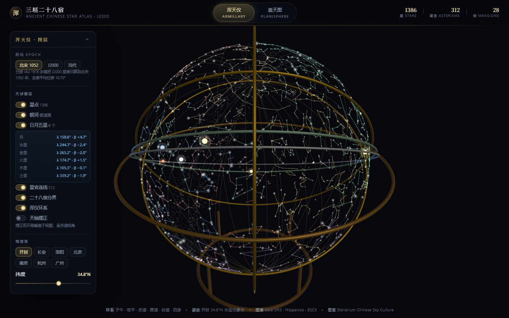
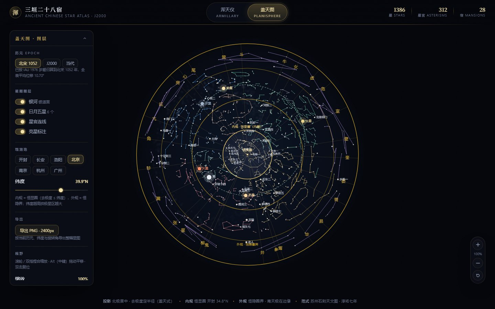

<div align="right">
  <b>English</b> &nbsp;·&nbsp; <a href="README.zh-CN.md">简体中文</a>
</div>

# 浑天仪 · Huntianyi

**An interactive reconstruction of the Chinese sky — the armillary sphere, the Three Enclosures and the Twenty-Eight Mansions — computed from real star catalogues, not stylised artwork.**

Every star sits at its measured position, precessed to the epoch of the Northern Song (1052 CE), when Su Song built his astronomical clock tower in Kaifeng. The same coordinate kernel drives both a 3D armillary sphere and a flat planisphere in the manner of the Suzhou stone star chart.



<p align="center"><em>Armillary sphere — epoch 1052 CE, latitude 34.8°N, Milky Way and the seven luminaries visible</em></p>

## Features

| | |
| --- | --- |
| **Two coordinated views** | A 3D armillary sphere with six rings (meridian, horizon, equator, ecliptic, lunar path, four-motion ring) and a 2D planisphere with two independently rotating discs |
| **Real precession** | IAU 1976 three-angle precession, switchable between **Northern Song 1052**, **J2000** and **present day** |
| **Authentic catalogue** | 1,386 stars, 312 asterisms, 28 lunar mansions — every star carries its traditional Chinese name |
| **Milky Way** | Generated from the true galactic plane (galactic centre and north galactic pole anchors), not a decorative band |
| **Sun, Moon, five planets** | Planetary positions from JPL/Standish elements; the Moon from Meeus. Retargeted to the selected epoch, so you see the sky of a Song-dynasty night |
| **Observable latitude** | Seven historical capitals (Kaifeng, Chang'an, Luoyang, Beijing, Nanjing, Hangzhou, Guangzhou) or any latitude by slider |
| **Sidereal time** | The sphere rotates by true local sidereal time; any moment can be dialled in, and dragging the chart moves the clock |
| **Shareable & exportable** | Epoch and latitude live in the URL; both views export PNG |

<p align="center">
  
  
</p>

## Quick start

```bash
git clone https://github.com/skywalkerqqq/huntianyi.git
cd huntianyi
npm install
npm run dev       # http://localhost:8771
```

```bash
npm run build      # production build (fully static)
npm start          # serve the build
npm run typecheck  # tsc --noEmit
npm run test:astro # astronomy assertions (GMST, solar position, precession)
```

Requires Node.js 20+.

## Why the numbers matter

This is the part that separates a star map from a reconstruction.

### Precession

The catalogue is stored at J2000 — its only ground truth. The Song sky is ~950 years earlier, and precession is not negligible at that distance. Recomputed with IAU 1976:

| Star | J2000 | 1052 CE | shift |
| --- | --- | --- | --- |
| 勾陈一 (Polaris) | 0.736° from pole | **5.916°** | 5.38° |
| 角宿一 (Spica) | 101.161° | 96.065° | 13.21° |
| 心宿二 (Antares) | 116.432° | 113.807° | 13.18° |
| All 1,386 stars | — | — | **mean 10.70°, max 13.22°** |

So in the 1052 sky Polaris stands nearly six degrees from the pole — which is what makes the Song records ("the pole star is a little over three degrees from the pole") intelligible. The circumpolar circle moves with it: **147** stars fall inside it at Kaifeng, versus 159 for uncorrected J2000 positions.

### Planetary reference frame

The Standish elements give heliocentric positions in the **J2000-fixed** frame, while the classical `sunRaDec()` formula yields ecliptic longitude referred to the equinox of date. The self-check is to back-compute the Sun's longitude from the Earth elements and compare: Δ = 0.005° at J2000, but 0.699° in 1950 — and 50 years × 50.29″/yr = 0.698°. The discrepancy is *exactly* precession. The coefficients are correct; the frame simply has to be rotated.

Planets therefore go through the same precession as the star catalogue, and `shiftToYear()` moves the clock's month and day into the epoch's year — so the planets you see really are those of a night in 1052.

### Sidereal time

`rotation = 270° − LAST` on the planisphere and `rotation.y = −(90° + LAST)` on the sphere produce the same sky. One clock hour moves the sky by 15.041°, not 15° — the sidereal day is 86164.0905 s, not 86400 s.

## Data

| Source | What it provides |
| --- | --- |
| [Stellarium](https://github.com/Stellarium/stellarium) Chinese sky culture | 312 asterisms, line topology, 28 determinative stars (HIP), Chinese star names |
| [`star-catalog-lite`](https://www.npmjs.com/package/star-catalog-lite) | TSC1 bright-star catalogue (Gaia DR3 / Hipparcos / BSC5) — 1,386 matched stars |

`src/data/chineseSky.json` is generated, never hand-edited:

```bash
npm run data:sky   # scripts/export_sky.mjs
```

Position check: five bright stars agree with the catalogue to Δ < 0.003°.

## Repository layout

```
src/
  app/           routes: / (armillary) and /flat (planisphere)
  components/    Armillary.tsx, SkyMap.tsx, TimeSync.tsx, Shell.tsx, ui.tsx
  lib/           astro.ts (sidereal time, precession), epoch.ts, planets.ts,
                 milkyway.ts, export.ts, sky.ts
  data/          chineseSky.json — generated catalogue
scripts/
  export_sky.mjs data pipeline: raw sources → chineseSky.json
  data/          raw Stellarium sources
  test_astro.mjs astronomy assertions
  verify*.cjs    end-to-end regression (Playwright)
docs/            design notes and screenshots
```

## Known limitations

- **No three-school colour coding** (Shi / Gan / Wu Xian — vermilion, ink and yellow). The authoritative dataset, the China-VO "asterism master table" carrying a `shu shi` (school) field, is offline: every file on that endpoint returns 404 and no archive exists. Stellarium's own `chinese_chenzhuo` culture encodes only region in its ids (P / S / H / numeral), not school. Reconstructing it needs manual work from the *Jin Shu* and *Kaiyuan Zhanjing*, so it is left for later rather than guessed.
- **Planisphere performance.** 1,386 stars, 420 polylines, the Milky Way path and the luminaries all live in SVG; page transitions take ~0.7–1.0 s. Moving the star layer to Canvas is the next step.
- **Accuracy.** Planets ~10′, Moon ~0.3° — enough for positional display, not for eclipse timing or occultation work.

## License

Code is **MIT © skywalkerqqq** — see [LICENSE](LICENSE).

The astronomical culture data under `scripts/data/` and the derived `src/data/chineseSky.json` originate from the Stellarium project and remain under their upstream terms; they are **not** covered by the MIT license above. See [LICENSE](LICENSE) for details.
